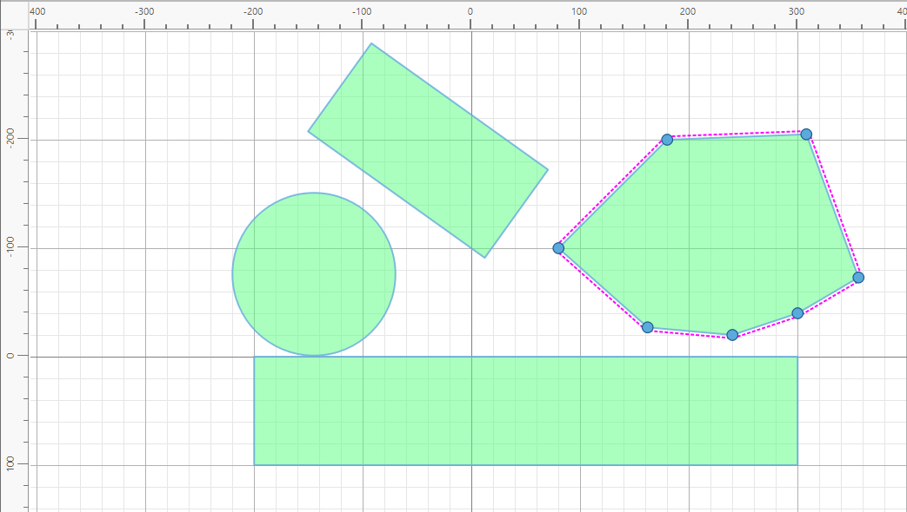

# Drawing shapes

Shapes are drawn in **Edit** mode, which you switch to with the **Edit** button
on the right of the toolbar. A shape is the drawing of an object: its outline,
size, position and colour. It takes no part in a simulation until it is made
into a body in [Physics mode](physics.md), so this is the place to get the
geometry right first.

## Kinds of shapes

Physalis has three kinds of shapes:

- **Rectangle**: a box with a width and a height. Its corners can be rounded
  with **Corner Radius**. A rectangle can be turned into a polygon (right-click
  it and choose **Convert to Polygon**) when you want to move its corners
  individually.
- **Circle**: set by its **Radius**. Circles roll, which makes them the natural
  choice for balls and wheels.
- **Polygon**: any outline made of straight edges. A polygon can be
  **closed**, so the last point joins the first, or **open**, like a line
  drawn through a series of points. What a polygon can do in a simulation
  depends on its outline:
  - A closed, **convex** polygon (no corners pointing inwards) can be a solid
    object that moves, falls and collides.
  - Any other outline, such as an open line or a closed shape with a notch, is
    treated as a set of edges. Edges are fine for fixed scenery such as ramps,
    walls and terrain, but they have no inside and therefore no mass, so they
    cannot belong to a body that moves. To make such a shape move, right-click
    it and choose **Split into Convex Pieces...**.

## Adding shapes

Choose **Rectangle**, **Circle** or **Polygon** from the **Add** button on the
toolbar or from the **Shapes** menu, or right-click an empty part of the canvas
and choose from **Add**. A rectangle or circle appears at once and is
selected, ready to be moved and sized.

A polygon is drawn point by point: click on the canvas at each corner. Then:

- press **Enter** to finish it as an open line,
- press **Shift+Enter** to finish it as a closed shape,
- press **Esc** to cancel it.

Every new shape gets a name such as `rectangle_3`. The name matters later,
because [rules](rules.md) refer to objects by name. It is worth giving
meaningful names, such as `floor` or `ball`, to the shapes you will use in rules.
Rename a shape in the **Name** field of its properties. Names must be unique,
and Physalis adjusts a name that is already taken.

## Selecting

- **Click** a shape to select it. It is outlined and gets handles.
- **Shift+click** adds shapes to the selection, or removes them from it.
  Shapes selected together move, resize and rotate together.
- **Click an empty part of the canvas** to clear the selection.
- **Ctrl+A** selects every shape on the field. In Physics mode it picks whole
  bodies, the same as clicking them one by one would.
- **Ctrl+click** reaches a shape lying under another one: each Ctrl+click on
  the same spot selects the next shape down.
- **Click a shape in the Objects tab** to select it from the tree.
- **Drag an empty part of the canvas** to draw a selection rectangle: every
  shape it touches is selected. This works in Physics mode too, where it picks
  bodies.

With several shapes selected, the **Properties** tab shows the selection
itself -- how many shapes it holds, where it starts, how big it is and how far
it is turned -- and changing one of those rows moves, resizes or turns the
whole selection as one piece, about its middle.

## Moving, resizing and rotating

A selected shape is in one of three states. **Double-click** the shape to go
from one state to the next, or use the buttons on the toolbar.

1. **Move / Scale** (the normal state). Drag the shape to move it, and drag one
   of the square handles around it to resize it.
2. **Rotate**. The shape shows its **origin**, the point it turns about, and a
   rotation handle. Drag the handle to turn the shape. The origin can be moved
   too, with **Origin X** and **Origin Y** in the properties or from
   **Move Origin To** in the right-click menu.
3. **Edit** (polygons only). Each corner point becomes a handle that can be
   dragged on its own, so you can reshape the outline.

   Click a point to pick it, **Shift+click** to pick more than one, and drag
   any picked point to move them all together. With points picked:

   - **Enter** on two neighbouring points puts a new point between them. On
     the two ends of an unclosed outline it joins them up instead, closing it.
   - **Shift+Enter** puts a new point in the middle of *every* edge the picked
     points span -- so picking the two ends of a run splits all of it at once,
     whether or not the points in between were picked.

     On a closed outline there are two runs between any two points, so the one
     that gets split starts at the point you picked **first** and goes
     **clockwise** from there. Pick the same two the other way round and the
     other half is split instead.

More ways to move a shape:

- **Arrow keys** move the selection by one unit at a time.
- **Shift** ignores the grid, so a shape, a handle or a point can be placed
  anywhere. It works held down before the drag starts as well as during it.
- **Left**, **Top** and **Rotation** in the properties place a shape exactly.
  Rotation is in degrees, clockwise.

## The right-click menu

Right-clicking a shape offers these commands:

- **Duplicate** (**Ctrl+D**) makes a copy next to the original. It copies the mechanism,
  not just the shapes: the bodies the shapes belong to come with them, and so
  does any joint whose *both* ends are in what you picked — so a wheel on an
  axle duplicates as a wheel on an axle, joined to its own copy rather than to
  the original. A joint with only one end in the selection has nothing on this
  side to hold, so it is left out and the status bar says how many were.
  Copy and Paste carry the same thing, and work between two windows.
- **Flip Horizontally** and **Flip Vertically** mirror the shape.
- **Convert to Polygon** (rectangles only) replaces the rectangle with a polygon
  of the same outline.
- **Move to Center** moves the shape to the middle of the field.
- **Move Origin To** puts the turning point at the centre or at one of the
  corners.
- **Snap to Grid** and **Snap To** decide whether the shape lines up with the
  grid when moved, and whether its top-left corner or its origin is the point
  that snaps.
- **Reset Rotation** turns the shape back to 0°.
- **Bring to Front**, **Bring Forward**, **Send Backward** and **Send to Back**
  decide which shape is drawn over which where they overlap. Without them a
  shape is drawn in the order it was added and nothing can change it. The order
  is saved with the scene. Shapes picked together keep their own order among
  themselves as they move through the pile.
- **Convert to Chain...** (circles only) replaces the circle with one closed
  outline of straight segments: a wheel, a ring, a hoop for other shapes to sit
  in. Choose how many segments it has and which angle it starts at.
- **Convert to Segments...** (circles and rectangles) replaces the shape with
  that many separate line shapes, each of which can be given a body and joined
  to its neighbours.
- **Split into Convex Pieces...** (closed polygons that are concave or have
  more points than a solid shape may) cuts the outline into convex pieces that
  together cover exactly the same area, so it can be solid and belong to a body
  that moves. Choose the most **corners per piece**; fewer gives more, smaller
  pieces. The pieces stay in the polygon's body, and the first one keeps its
  name, so rules that named it still find it.
- **Delete** removes the shape. The **Delete** key does the same.

## Lining shapes up

With more than one shape selected, the toolbar's **Align** list arranges them:

- **Align Left**, **Centres Across**, **Right**, **Top**, **Centres Down** and
  **Bottom** line them up on an edge or a middle;
- **Distribute Across** and **Distribute Down** leave the first and the last
  where they are and space the rest evenly between them, by the gap between
  shapes rather than by their centres, so shapes of different sizes end up
  evenly spaced;
- **Ring Outside** and **Ring Inside** lay them round a circle, each turned to
  face the ring, either standing on it or hanging inside it. The ring is as
  small as it can be without the shapes overlapping.

## Tools

The toolbar's **Tools** list works on whatever is selected. Each tool opens a
small panel in the bottom-left corner of the canvas with its own settings, and
the canvas shows the result as the settings change. **Apply** keeps it,
**Cancel** -- or clicking anywhere outside the panel -- puts the scene back.

- **Clone...** fills a grid with copies of the selection: how many **rows** and
  **columns**, and the **gap** across and down between them. Unlike Duplicate
  it copies the shapes alone — the copies are in no body and carry no joints.
- **Mirror...** puts a mirrored copy beside the original, on the **side** you
  choose -- right, left, top or bottom -- at the **margin** you give.

Both are ordinary edits: Undo takes them back.

## Shape properties

With a shape selected, the **Properties** tab shows two pages.

**Geometry** holds the shape's name, position and size: **Left** and **Top**
(the position of its top-left corner on the field), **Width** and **Height**
(or **Radius** for a circle), **Corner Radius** for a rectangle, and
**Rotation**.

A polygon has three more rows, which decide how the outline is built for the
simulation:

- **Built as** offers only the choices the outline allows:
  - **Polygon**: one solid, filled shape. It is the only choice with an
    inside, and so the only one that can belong to a moving body. It needs a
    closed, convex outline within the point limit set in
    [Options → Physics](options.md).
  - **Chain**: the edges joined into one smooth surface, so that nothing
    catches where two edges meet. A chain stops things from one side only and
    needs at least four points. It suits terrain and curved ramps.
  - **Segments**: each edge on its own. Segments stop things from both sides,
    but something sliding along them can catch at a joint.
- **Segments** shows how many edges the outline is built from.
- **Filled** chooses whether a solid polygon is drawn filled or as an outline.

**Appearance** controls only how the shape is drawn and has no effect on the
simulation:

- **Body Color** is the fill colour, and **Transparency** is how much of what
  lies behind shows through it.
- **Border Width** and **Border Color** set the outline.
- **Line Cap** and **Line Join** set how the ends and corners of the outline
  are drawn. They matter mostly for open polygons.

The default colours and outline for new shapes are set in
[Options → Shapes](options.md).

A box swept over empty field picks everything it touches -- shapes, **rays**
and **explosions** together, as many of each as the box covers. Two blasts, two
rangefinders and a body come back from one sweep as one selection, and
**Delete**, the arrow keys, dragging any of them, and **Copy** then act on all
of it. Hold **Shift** to add another boxful to what is already picked.

A fresh box says what the whole selection is: a sweep that catches no blasts
leaves none picked. Clicking one thing picks that thing alone, even out of a
group -- so a set picked by mistake is undone with one click.

A **joint** is the exception: it is a linkage rather than something with a
place of its own, so picking one lets everything else go, and picking anything
else lets it go. The property panel shows one object at a time; where several
are picked it shows the first, and the rest are still picked.

## Names on the canvas

**Show Names** -- on the canvas's right-click menu, on **View**, or
**Ctrl+Shift+N** -- writes each object's name beside it. It is **off** by
default, since a field of labels is in the way of the drawing most of the time,
and the choice is remembered.

A body speaks for the shapes in it: a body of five plates gets one label, not
six. Shapes in no body, joints, rays and explosions each get their own. The
labels stay the same size whatever the zoom, so they are still readable zoomed
right in, and they are drawn during a run too.

## The canvas right-click menu

Right-clicking the canvas offers what belongs to the canvas rather than to one
shape: **Paste**, **Select All**, **Fit to Field**, **Reset Zoom** and
**Show Names**. These are there whether or not a shape is under the pointer,
and the view commands stay available **during a run** -- framing the field or
reading the names is exactly what a run is watched with.

## Zoom, grid and snapping

- The zoom box on the toolbar sets the scale of the view: pick a preset or
  type a value. **Ctrl + mouse wheel** over the canvas zooms as well (**Shift**
  does the same), and the magnifier button -- or **Ctrl+0** -- returns to 100%.
  A notch of the wheel changes the zoom by a share of where it already is, so
  coming back out from 500% takes as many notches as going in did; the share is
  set in [Options → Common](options.md).
- **Fit to Field** on the **View** menu, or **Ctrl+Shift+0**, zooms so the
  whole field is in view.
- Drag an empty part of the canvas to move the view.
- The field's size and colour, the grid, and how snapping works are set in
  [Options → Common](options.md). The field's size and colour can also be
  changed for the current scene in its properties: click an empty part of the
  canvas to show them.
