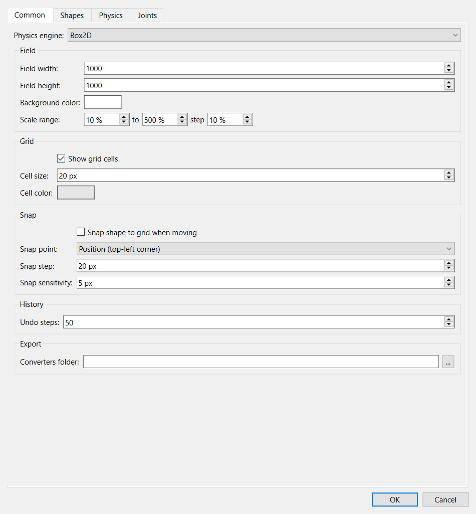
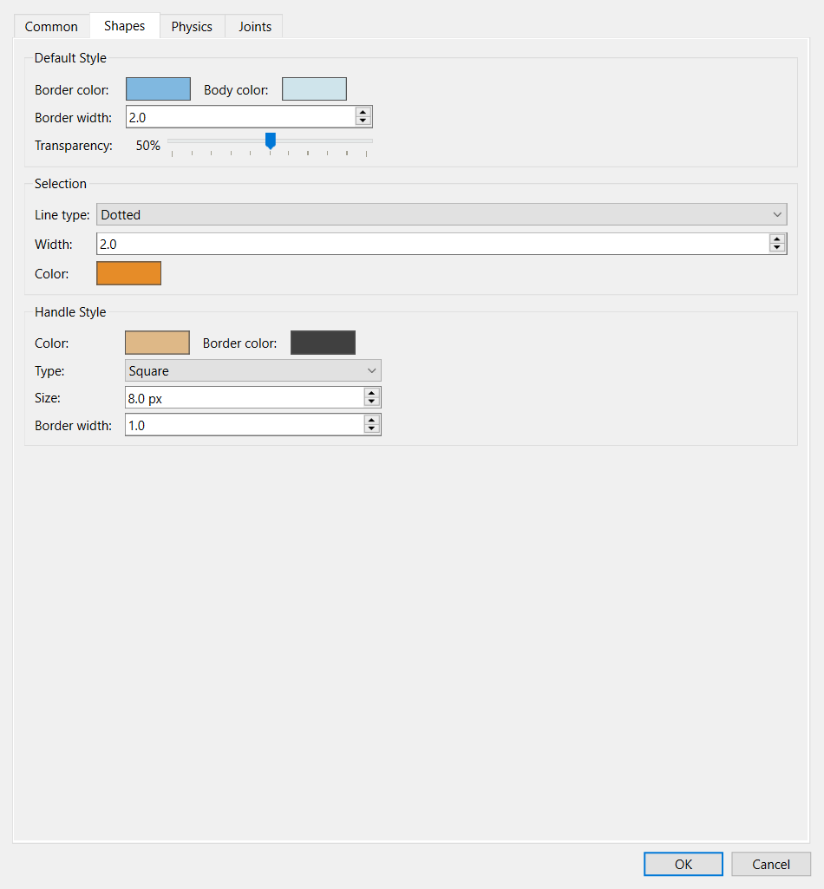
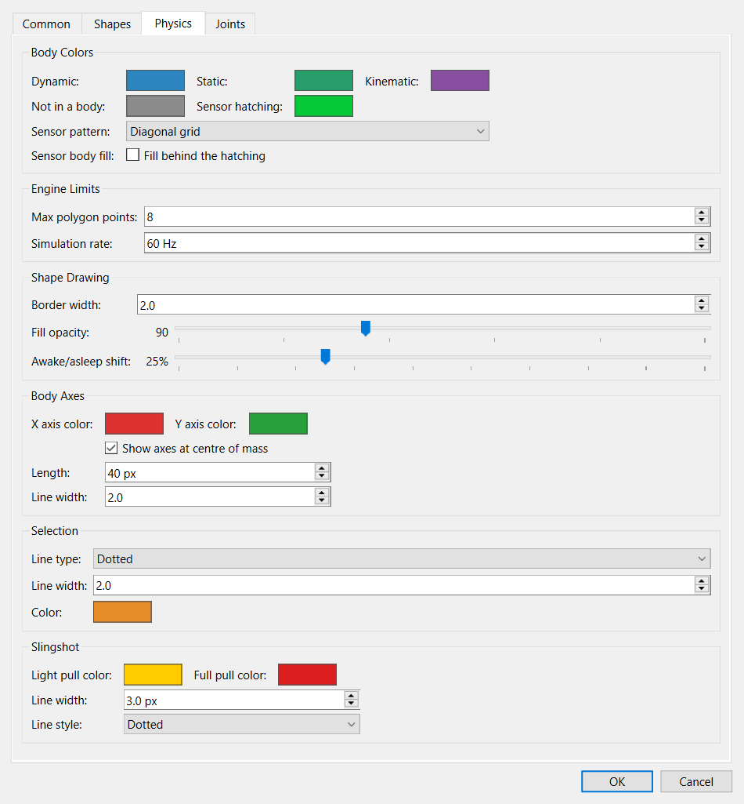
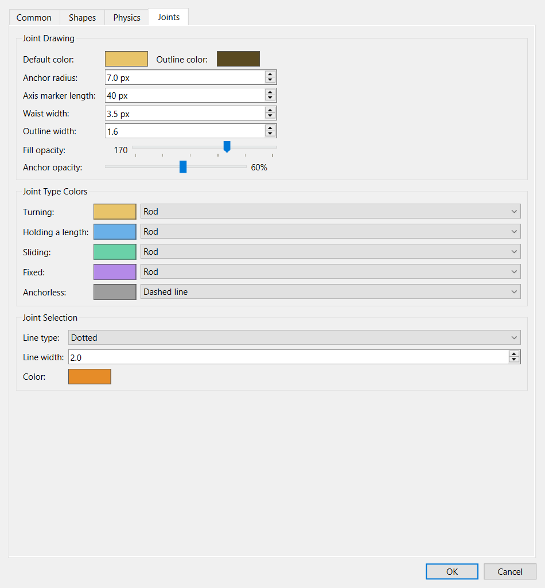

# Options

**File → Options…** holds the application's settings. They are saved when you
press OK and apply to every scene, now and in future sessions. Settings that
belong to a single scene, such as its gravity or scale, are not here; you find
them in the scene's own properties, shown when nothing is selected.

## Common

- **Physics engine** chooses the [engine](engines.md) that new scenes use.
- **Colour scheme** is how the windows and panels look: Light, Dark, Nord,
  Gruvbox, Solarized, Dracula and a dozen more, or System to follow the
  desktop. The field keeps its own colours.
- **Style** is the shape of fields, buttons, tabs and checkboxes -- Rounded,
  Sharp, Fluent, Material or Minimal -- and goes with any colour scheme.

  Neither is built into Physalis: both are files you can add to or change
  yourself. See [Colour schemes and styles](themes.md).
- **Rulers show** picks what the rulers along the canvas are numbered in:
  scene units, millimetres, centimetres, metres or kilometres. Right-clicking
  either ruler picks it too. Anything but scene units is worked out from
  **Physics -> Pixels per metre**, so the same drawing reads as four metres at
  100 and as forty centimetres at 1000.
- **Field** sets the default size and background colour of the field for new
  scenes, and how far you can zoom in and out. The **step** is how much one
  notch of the wheel changes the zoom, as a share of where it already is: at
  10%, 100% becomes 110% and 500% becomes 550%, so zooming out from far in
  takes as many notches as zooming in did.
- **Grid** sets whether the grid is shown by default, the size of its cells and
  its colour.

The field and the grid belong to the scene: each is saved in the `.phys` file
and comes back with it. What is set here is what a **new** scene starts with,
so changing it leaves the scene that is open exactly as it was drawn.
- **Snap** decides whether shapes line up with the grid when they are moved,
  which point of a shape lines up (its top-left corner or its origin), the
  snap step, and how close a shape has to come before it snaps.
- **History** sets how many steps **Undo** can go back.

## Shapes

The colours and outline that new shapes are drawn with, how a selected shape
is outlined, and the size and colour of the handles used to resize and rotate
shapes.

## Physics

- **Body Colors** are the colours used for dynamic, static and kinematic bodies,
  for shapes that are not in a body, and for the hatching of sensors.
- **Engine Limits** sets the largest number of points a solid polygon may have
  and the rate at which the simulation is calculated.
- **Shape Drawing** sets how bodies are outlined and filled, and how strongly
  **Sleep shading** tints bodies that have come to rest.
- **Body Axes** controls the centre-of-mass cross drawn on each body: whether it
  is shown, and its colours, length and width.
- **Selection** sets how a selected body is outlined.
- **Slingshot** sets the colour of the pull line for a light pull and for a
  full pull, its width and its style. See [the slingshot](running.md#the-slingshot).
- **Trail** sets the colour, width and line style of the line a body marked
  **Draws a Trail** leaves behind it. See [trails](running.md#trails).

## Joints

- **Joint Drawing** sets how joints are drawn: their colours, the size of the
  anchor rings, and how transparent the anchors are (**Anchor opacity**), so
  the shapes under them stay visible.
- **Joint Type** gives each kind of joint its own colour and line
  style: turning, holding a length, sliding, fixed, and without anchors.
- **Springs** controls joints whose spring is on, which are drawn as coils:
  whether to draw them that way at all, the **Coil pitch** (how much rest
  length one turn stands for -- smaller gives a finer spring with more turns)
  and the **Coil width**.
- **Joint Selection** sets how a selected joint is outlined.

## Export

One page for each [export format](exporting.md), holding that format's own
settings.
