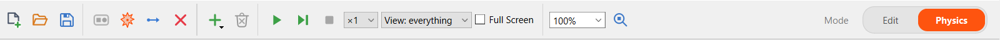
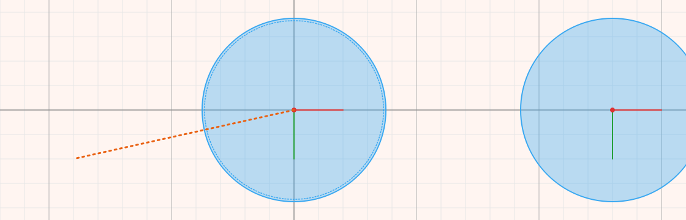

# Running a simulation

When the scene is ready, run it to see how it behaves. The controls are on
the toolbar in **Physics** mode.

## Starting, pausing and stopping

- **Simulate** (▶) starts the simulation. While it runs, the same button
  pauses it, and pressing it again carries on.
- **Step** moves the simulation on by a single frame and then holds it. Step
  through a collision frame by frame to see exactly what happens.
- **Stop** (■) ends the simulation and puts every body back exactly where it
  was before you started. Nothing that happened during the run is kept, so you
  can run a scene as many times as you like.

While a simulation runs, the scene cannot be edited. You can still move the
view by dragging the canvas, zoom, look at values in the Properties tab, and
fling bodies with the [slingshot](#the-slingshot).

## Playback speed

The **×1** box sets how fast the simulation plays, from ×¼ to ×8. At ×2, two
seconds of the simulation pass in one second of real time. Only the pace
changes: the physics is calculated in the same way at every speed, so a scene
ends the same whether you watch it slowly or quickly.

## What is shown during a run

The **View** list chooses which helpers are drawn while the simulation runs.
Tick any combination:

- **Grid**, the background grid;
- **Joints**, the joints and their anchors;
- **Body axes**, the centre-of-mass cross on each body;
- **Rays** and **Explosions**;
- **Sleep shading**, which tints each body by whether the engine is still
  calculating it or has put it to sleep because it has come to rest.

These choices affect only the running simulation. While you edit, everything
is always drawn, because that is when you need to see and place it.

In the top-left corner, stacked under one another, are the three things a run
shows that are not part of the scene's drawing: the **log** of values being
watched, the **caption** a rule has put up, and the scene's own **controls**.
Each appears only if there is something to show, and they are gone again when
the run stops.

## Keeping one body in view

A scene bigger than the window leaves whatever you are watching sliding off the
edge. Tick **Keep In View** on a body's properties and the view follows it
instead: it stays in the middle of the screen and the scene moves around it.

A rule can hand the view over while the run is going -- the action is **Keep in
view** on a body, so *when the ball falls in the pocket, watch the next one*
works -- and when the run ends the view goes back to the body the scene itself
names.

One body at a time -- a view has one middle, so giving it to another takes it
off the first. It applies while the simulation runs, not while you edit, where
panning is yours; and it follows the body past the edge of the field, so a
body thrown out of the world is still watched. The full-screen window follows
the same body, and so does an [exported](exporting.md) scene.

## Working the scene while it runs

A scene is not only watched. Two things reach into a run:

- **The keyboard.** A rule can watch for a key being pressed, held or
  released, on its own or with Ctrl, Shift or Alt. Held is the one that keeps
  a force on for as long as the key is down. Click the canvas first, so the keys go to
  the scene rather than to the panel you last used. No key is reserved: if a
  scene wants the space bar, it has it.
- **The scene's own controls.** A checkbox, a button or a slider declared on
  the **Controls** tab appears over the canvas while the run is going. Rules
  read what each one is set to, fire on a press, a release or a change, and can
  grey one out or change what it says.

Both are described under [Rules](rules.md#keys-and-controls). A control is run
state, like everything else a run produces: it starts each run where the scene
says, and goes back there when the run stops.

## Full screen

With **Full Screen** ticked, Simulate opens the simulation in a window of its
own that fills the screen, with the field as large as it fits. **Esc** ends the
simulation and returns to the editor.

Esc is the only key the window keeps. Every other key goes to the scene, so a
rule watching the keyboard works there exactly as it does in the editor -- and
a scene that uses the arrows or the space bar is not fighting the window for
them. The caption, the log and the scene's controls are all shown there too.

Drag to move the view, turn the mouse wheel to zoom, and press **0** to fit the
whole field again.

## Watching values

To follow a value while the simulation runs, such as a ball's speed, a
joint's angle or the time elapsed, right-click its name in the Properties tab
and choose **Add to Log**. Logged values are listed in the top-left corner of
the canvas while the simulation runs, each with the name of its object, and
they update every frame. Right-click a logged property again and choose
**Remove from Log** to stop watching it, or **Clear Log** to remove them all.

A scene's own [variables](rules.md#variables) go in the log the same way:
right-click one on the **Variables** tab and choose **Add to Log**. That is how
to watch a score count up, or a timer count on, while the scene runs.

The log is also the quickest way to find out why a [rule](rules.md) does or
does not fire: watch the value the rule compares.

## Plotting values

A logged value shows one number at a time. To see what it did over the whole
run, right-click its name and choose **Add to Log as Plot** -- or, if it is
already logged, **Plot as Well**. It is then drawn on the **Plot** tab.

Each value gets a band of its own, with its own vertical scale: a force in
newtons and a position in scene units share no scale worth sharing. The band is
labelled with the object and property it belongs to and the value at the end of
the trace. The vertical scale covers everything the value has reached since the
run started, so it does not shift under you as new samples arrive.

The plot shows the last **five seconds** and scrolls along with the run, since
a whole minute squeezed into the panel is a solid block. To look elsewhere:

- **Mouse wheel** -- show more or less time at once.
- **Drag sideways** -- walk back through the run.
- **Right-click** for **Show Whole Run**, to fit all of it at once; **Clear
  Traces**, to start recording again from here; and **Save as CSV...** or
  **Save as Image...**.

The CSV has one time column and a column per value, so it opens in a
spreadsheet as it stands. A sample is taken on every simulation step rather
than every drawn frame, so the trace is the same whatever speed the run was
played at, and a scene too heavy to draw smoothly still records every step.

Traces belong to the run: pressing **Simulate** again starts fresh ones.

## The slingshot

Any dynamic body can be flung with the mouse during a run, like a ball hit with
a pool cue. First tick **Can Be Shot** on the body's **Body** page. Then, during
the simulation:

1. Press the mouse button on the body.
2. Pull back. A line runs from the body to the pointer, and its colour changes
   from the light-pull colour to the full-pull colour as the pull grows.
3. Let go. The body is pushed in the opposite direction, through its centre of
   mass, harder the further you pulled.

Press **Esc**, or click the right mouse button while pulling, to cancel.

Two settings on the body decide how strong the shot is:

- **Max Power** is the push at full pull.
- **Max Pull** is how far you have to pull, in field units, for full power.
  Pulling further adds nothing.

A body that can be shot has a dotted line just inside its outline, so it is easy
to recognise. A shot reaches through shapes that cannot be shot, so a ball
lying under a table can still be fired. The colours, width and style of the
pull line are set in [Options → Physics](options.md).

## When something goes wrong

A scene may ask the engine for something impossible, such as a motor thousands
of times stronger than what it drives. Instead of crashing, Physalis takes the
body that has run out of control out of the simulation and reports what
happened in the status bar. Press **Stop** to put the scene back, then reduce
the value that caused the problem.
